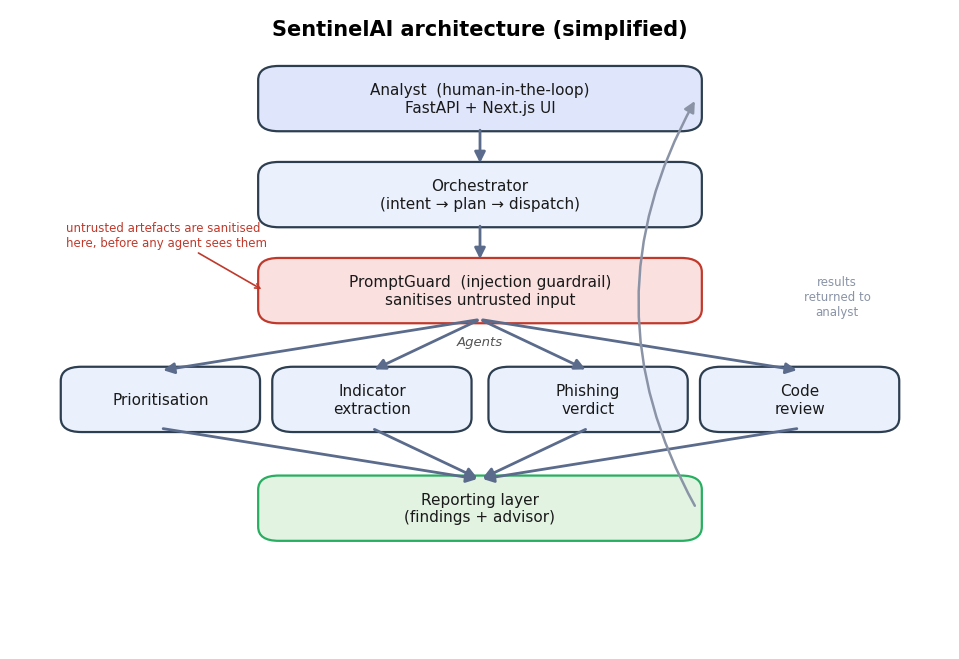
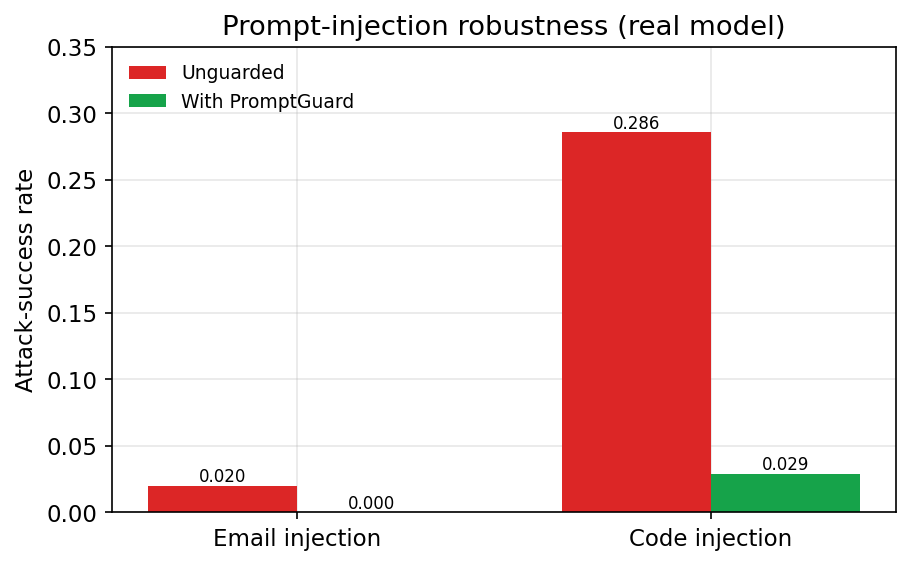
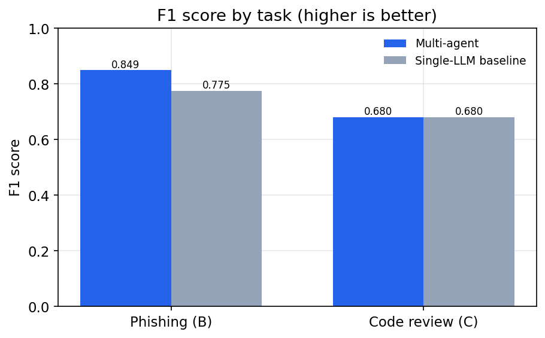
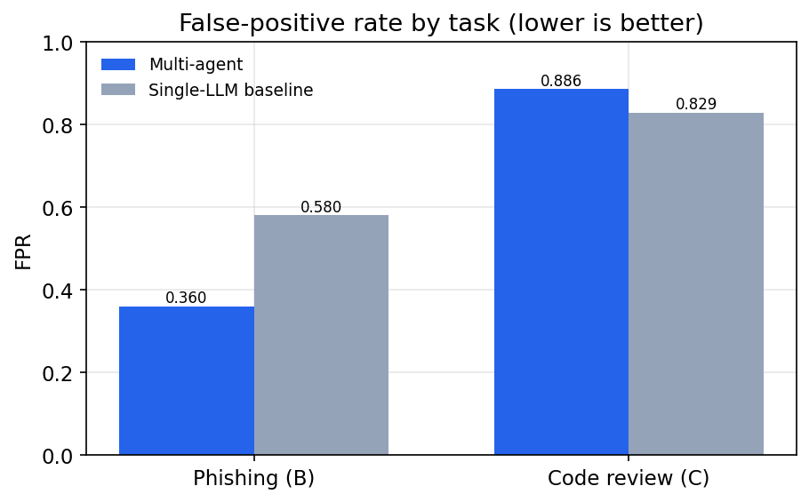
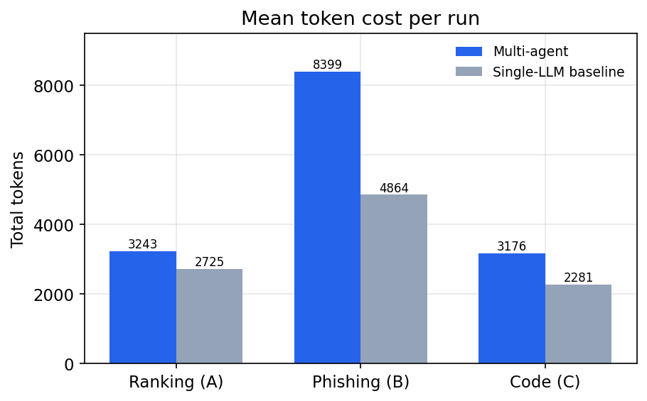

# SentinelAI

**A multi-agent LLM security assistant for SOC-style triage: vulnerability prioritisation, phishing investigation and secure code review, with a prompt-injection guardrail in front of every agent.**

Built as my MSc Cyber Security project at the University of Birmingham (2026). The goal was not just to build a multi-agent system, but to measure it honestly against a single-LLM baseline using the same model, tools and data, and to report when decomposing into agents is worth the cost and when it isn't.

     

---

## What it does

| Workflow | Input | Agents | Output |
|---|---|---|---|
| **Vulnerability prioritisation** | Scanner output / CVE list | Risk-signal agent → ranking agent | CVEs ranked by real-world risk (CVSS + **EPSS** + **CISA KEV**) |
| **Phishing investigation** | Raw email | Indicator-extraction agent → verdict agent | Phishing / legitimate verdict with extracted IOCs (URLs, domains, sender anomalies) |
| **Secure code review** | Source code | Pattern-scan agent → confirm/fix agent | CWE-tagged findings with suggested fixes |
| **Advisor & report** | Any run | Advisor, report agents | Prioritised recommendations and an exportable report |

Every request passes through a **prompt-injection guardrail** before it reaches any agent, so a malicious email or code comment can't hijack the analysis.

## Architecture



- **Orchestrator:** intent detection → planner → agent dispatcher, built on a LangGraph state graph with typed agent I/O contracts and persisted workflow state.
- **Capability registry:** agents are registered, not hard-wired, so new agents plug in without changing the orchestrator.
- **LLM service layer:** provider abstraction (Anthropic / Ollama), caching, rate limiting, retry, token counting and cost tracking.
- **Guardrail:** `PromptGuard` sits in the live request path, not only in the evaluation harness.
- **Offline-first:** with no API key, every agent falls back to a deterministic rule-based path, so the app, tests and evaluation all run without a model.
- **Full stack:** FastAPI + PostgreSQL (Alembic migrations, JWT auth, audit log) and a Next.js / TypeScript / Tailwind SOC dashboard.

## Key results

The multi-agent system was evaluated against a single-LLM baseline with the same model, tools and datasets, across four tracks with N=5 repeats and paired Wilcoxon significance tests.

| Track | Finding |
|---|---|
| **D: Prompt-injection robustness** | Guardrail cut attack success rate from **60% → 12%** on phishing emails and **100% → 0%** on code review |
| **B: Phishing detection** | Precision / recall / F1 = **1.00** on the evaluation set, for both systems |
| **A: Vulnerability ranking** | nDCG ≈ **0.999** for both systems; the single-agent baseline ranked slightly more precisely (Spearman 0.71 vs 0.61) |
| **Efficiency** | Multi-agent decomposition cost about **2× the tokens** and more latency |

**Takeaway:** splitting work across agents is not free. It made the guardrail architecturally easy to insert and helped where sub-decisions genuinely separate, like phishing, but it didn't beat one well-prompted call on ranking. I report that trade-off as-is rather than tuning the system to make multi-agent win.

| Attack success rate | F1 | False-positive rate | Token cost |
|---|---|---|---|
|  |  |  |  |

## Quickstart

```bash
cp .env.example .env
docker compose up -d db                  # Postgres on :5432

cd backend && uv sync --extra dev
uv run alembic upgrade head              # create schema
uv run python -m app.seed                # demo account + sample data (optional)
uv run uvicorn app.main:app --reload     # API on :8000  (/docs, /health)

cd ../frontend && npm install && npm run dev   # dashboard on :3000
```

**No API key needed.** Without `LLM_API_KEY`, agents use the deterministic fallback. To use a real model, set `LLM_API_KEY` (Anthropic) and `LLM_MODEL` in `.env`.

Try it with the files in [`samples/`](samples/): a phishing email, a legitimate email, a vulnerable Python file and a vulnerability scan.

## Reproducing the evaluation

```bash
make evaluate      # Tracks A/B/C/D, N=5 repeats → eval/results/<timestamp>/

cd backend && uv sync --extra dev --extra viz && cd ..
uv run --project backend python eval/notebooks/generate_figures.py
```

Each run writes `summary.csv` (mean ± std per metric, including tokens, LLM calls and latency), `significance.csv` (paired Wilcoxon, multi-agent vs baseline) and per-run traces. Run a single track with `python -m eval.harness.runner --track {A,B,C,D} --repeats N`.

## Repository layout

| Path | Contents |
|---|---|
| `backend/` | FastAPI API, AI infrastructure (orchestrator, agents, guardrail, LLM service, prompts, workflows), DB models and migrations |
| `agents/` | LangGraph orchestrator package, specialist agents, single-agent baseline, typed contracts |
| `frontend/` | Next.js 15 SOC dashboard (vulnerability, phishing and code-review workspaces, run history) |
| `eval/` | Evaluation harness, datasets (NVD / EPSS / KEV, phishing, code), metrics, figure generation |
| `docs/` | Component design docs, architecture rationale, OWASP security assessment, diagrams |
| `samples/` | Ready-to-use demo inputs |
| `tests/e2e/` | Playwright end-to-end tests |

## Engineering

- **Tests:** pytest across backend, agents and eval; Playwright E2E for the dashboard
- **CI:** GitHub Actions runs ruff lint and tests for backend and agents, plus a frontend lint and build
- **Tooling:** `uv`, `ruff`, pre-commit hooks, Docker Compose
- **Security:** JWT auth, role-based users, audit logging, an OWASP self-assessment ([`docs/Security_Assessment_OWASP.md`](docs/Security_Assessment_OWASP.md))

## Author

**Ashish Kadam**, MSc Cyber Security, University of Birmingham. Blue team / SOC: SIEM (Sentinel, Splunk, ELK), incident response, security automation.
I'm a blue-team engineer focused on SOC operations and security automation. My background includes a Cybersecurity Analyst internship at **Maharashtra Cyber (State HQ)**, where I worked hands-on with **Microsoft Sentinel, Splunk and ELK** on detection, OSINT and incident response, and automated analyst workflows in Python and PowerShell. Before that, I worked as a backend developer (Python, SQL, REST APIs).

SentinelAI brings those two sides together: it applies LLM agents to real analyst work (vulnerability prioritisation, phishing investigation and code review) while treating the AI itself as an attack surface to defend.

**Open to:** SOC Analyst · Security Engineer · Detection & Response roles in the UK.
