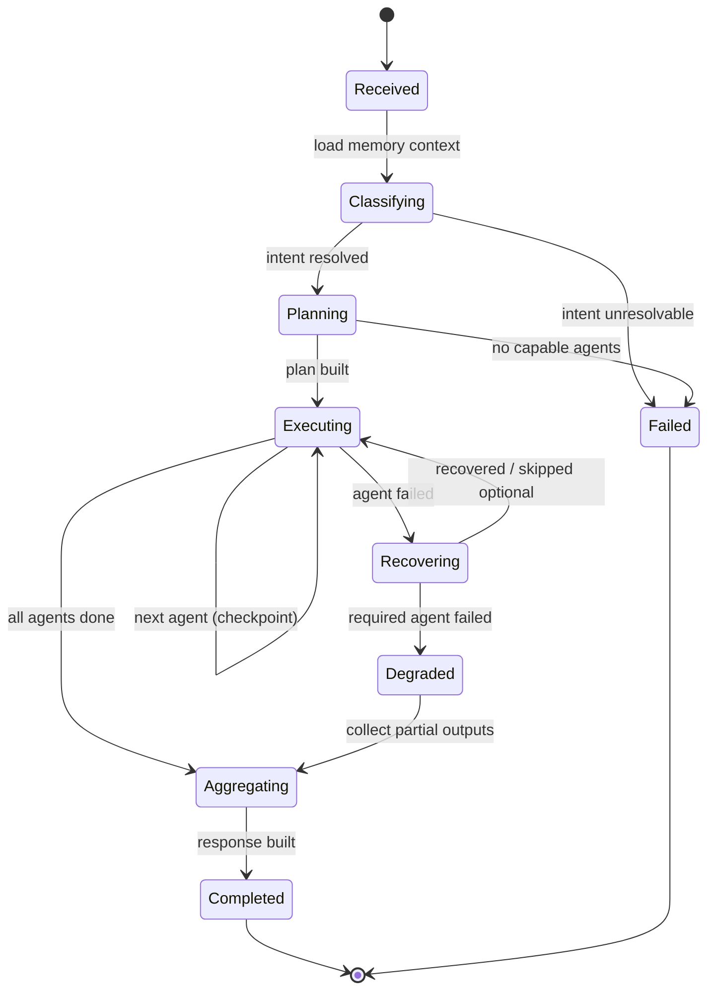
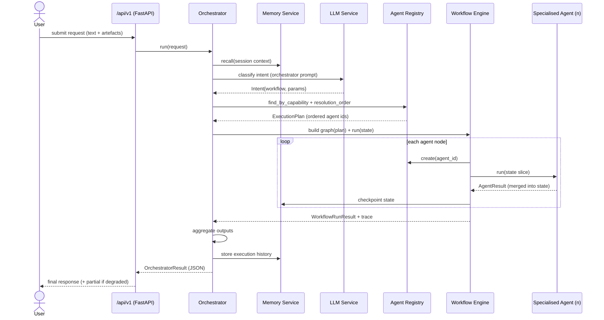
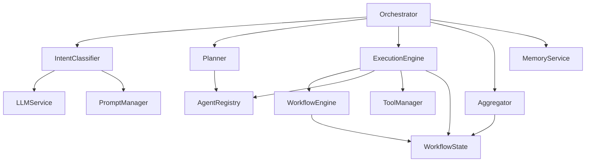

# SentinelAI — Orchestrator Agent (Phase 3 Architecture)

> Enterprise architecture documentation. **No implementation code.** This design
> builds on the completed AI platform (`backend/app/ai/`): Agent Registry, Workflow
> Engine, Workflow State, LLM Service, Memory Service, Tool Manager, Prompt Manager.

## 1. Objective & boundaries

The Orchestrator is the **AI brain** of SentinelAI. It coordinates; it does **not**
analyse. It never inspects a vulnerability, classifies an email, or reviews code —
that is the specialised agents' job. The Orchestrator turns a user request into a plan
of agent calls, executes that plan over shared state, recovers from failures, and
returns a single consolidated response.

**In scope:** intent understanding, planning, agent selection, execution, state
management, output collection, failure handling, final response.
**Out of scope:** any domain/cybersecurity logic; that lives in the specialised agents.

## 2. Responsibilities

| # | Responsibility | Mechanism (existing platform) |
|---|----------------|-------------------------------|
| R1 | Understand user intent | LLM Service + Prompt Manager (`orchestrator` prompt) → structured intent |
| R2 | Plan execution | Planner maps intent → ordered agent set |
| R3 | Select required agents | Agent Registry (capability lookup + `resolution_order`) |
| R4 | Execute workflow | Workflow Engine (nodes = agent invocations) |
| R5 | Manage shared state | `WorkflowState` (reducer-safe, persistable) |
| R6 | Collect outputs | Response Aggregator reads `state.outputs` |
| R7 | Handle failures | per-node retry / `on_error` recovery + degraded responses |
| R8 | Return final response | Aggregator → typed `OrchestratorResult` |

## 3. Architecture

The Orchestrator is a thin coordination layer composed of four collaborators, each a
small interface, all depending **inward** on the platform — never on a concrete agent.

```
            ┌──────────────────────── Orchestrator ────────────────────────┐
            │  IntentClassifier → Planner → ExecutionEngine → Aggregator    │
            └───────┬───────────────┬──────────────┬────────────┬──────────┘
                    │               │              │            │
              LLM Service      Agent Registry  Workflow Engine  Workflow State
              + Prompt Mgr     (capabilities,  (nodes, retry,   (+ Memory for
                               resolution)     recovery, trace)  history/context)
                                                     │
                                               Tool Manager (per-agent allow-lists)
```

- **IntentClassifier** — uses the LLM Service + the `orchestrator` prompt to convert
  free-text/upload context into a structured `Intent` (workflow type, parameters,
  confidence). Falls back to deterministic routing (file-type / explicit workflow)
  when the LLM is offline or low-confidence.
- **Planner** — maps `Intent` → `ExecutionPlan` (ordered list of agent ids) by querying
  the Agent Registry for capabilities and computing `resolution_order()` so each agent
  runs after its dependencies.
- **ExecutionEngine** — builds a Workflow Engine graph from the plan (one node per
  agent), threads `WorkflowState`, applies retry/timeout/recovery, and records a trace.
- **Aggregator** — consolidates `state.outputs`, recommendations, and reports into one
  `OrchestratorResult`, including partial/degraded results when some agents failed.

The Orchestrator itself is a `BaseAgent` subclass (it *is* an agent — the meta-agent),
so it inherits validation, metrics, timeout, and the JSON-only result contract, and it
registers in the Agent Registry like any other agent.

## 4. Folder structure (proposed)

```
backend/app/ai/orchestrator/
  __init__.py
  orchestrator.py        # Orchestrator (BaseAgent): the run() entrypoint / coordinator
  intent.py              # IntentClassifier + Intent model
  planner.py             # Planner + ExecutionPlan model
  execution.py           # ExecutionEngine: plan -> Workflow Engine graph -> run
  aggregator.py          # ResponseAggregator + OrchestratorResult model
  interfaces.py          # Protocols: Classifier, Planner, Executor, Aggregator
  models.py              # Intent, ExecutionPlan, PlanStep, OrchestratorResult
  policies.py            # Retry/timeout/degradation policy objects (config-driven)
tests/ai/orchestrator/   # unit tests per collaborator + end-to-end (fake agents)
docs/diagrams/orchestrator_*.mmd
```

Each collaborator is independently testable with fakes (DI throughout), mirroring the
platform's existing style.

## 5. Interfaces (contracts — described, not implemented)

- `Classifier.classify(request) -> Intent` — request context → structured intent.
- `Planner.plan(intent) -> ExecutionPlan` — intent → ordered, dependency-resolved steps.
- `Executor.execute(plan, state) -> WorkflowRunResult` — run the plan over state.
- `Aggregator.aggregate(state, run_result) -> OrchestratorResult` — final response.
- `Orchestrator.run(AgentRequest) -> AgentResult` — the public entrypoint (inherited
  `BaseAgent` contract; `output` carries the `OrchestratorResult`).

Data contracts: `Intent{workflow, params, confidence}`,
`ExecutionPlan{steps: [PlanStep{agent_id, optional, depends_on}]}`,
`OrchestratorResult{status, intent, agent_outputs, recommendations, reports, errors,
warnings, trace, usage}`.

## 6. Workflow (end-to-end)

1. **Receive** — `run(request)` with user text + uploaded artefacts + session id.
2. **Recall** — load relevant context from the Memory Service (conversation/project).
3. **Classify** — IntentClassifier → `Intent` (LLM or deterministic fallback).
4. **Plan** — Planner queries the Registry → `ExecutionPlan` (resolution-ordered).
5. **Build graph** — ExecutionEngine maps each step to a Workflow Engine node.
6. **Execute** — run the graph; each node creates the agent via the Registry, grants it
   its Tool Manager allow-list, runs it, and merges its output into `WorkflowState`.
   Checkpoint state after each node (recovery).
7. **Recover** — on node failure: retry; then `on_error` route to a recovery/skip node;
   optional agents are skipped, required failures mark the run degraded/failed.
8. **Aggregate** — Aggregator consolidates outputs → `OrchestratorResult`.
9. **Persist** — write execution history + summary to Memory; emit trace.
10. **Return** — single `AgentResult` (JSON), including partial results if degraded.

## 7. State machine



`Completed` = all required agents succeeded. `Degraded` = some optional/required agents
failed but a partial, useful response is returned. `Failed` = cannot proceed (no
intent / no capable agents / required-agent hard failure with no fallback).

## 8. Sequence diagram



## 9. Dependency graph



Dependencies point **inward** to the platform; the Orchestrator depends on **interfaces**
(capabilities, the `Agent` protocol), never on a concrete specialised agent — so new
agents are added with zero Orchestrator changes.

## 10. Error handling

- **Layered**: node-level (Workflow Engine retry + `on_error`), plan-level (optional vs.
  required agents), and orchestrator-level (degraded vs. failed response).
- **Isolation**: one agent's exception/timeout never crashes the run — it becomes a
  structured failure event and routes to recovery.
- **Degradation**: if an *optional* agent fails, it's skipped and noted as a warning; if
  a *required* agent fails after retries, the run is `Degraded` (return partial) or
  `Failed` per policy.
- **Observability**: every failure is recorded in `WorkflowState.errors`, the engine
  trace, and the Memory execution history, keyed by run id.

## 11. Retry logic

- **Where**: per-agent node in the Workflow Engine (`retries`, `retry_backoff_s`).
- **What retries**: transient failures (LLM/tool errors, timeouts). **Never** retried:
  validation errors and permission denials (deterministic — retry won't help).
- **Backoff**: linear by attempt (configurable); idempotent agents only — agents declare
  idempotency in their registry metadata so the Planner knows what is safe to retry.
- **Budget**: a global per-run retry budget caps total retries to bound latency/cost.

## 12. Timeout strategy

- **Per-agent (node)**: soft, thread-based timeout (`timeout_s`); a hang becomes a
  failure that flows into retry/recovery.
- **Per-run (orchestrator)**: a wall-clock budget; on breach, stop scheduling new agents,
  aggregate whatever completed, and return `Degraded`.
- **Per-LLM-call**: the LLM Service `PromptExecutor` enforces its own timeout + retry,
  so classification/aggregation calls can't hang the run.
- **Defaults are config-driven** (`policies.py`) and overridable per agent via registry
  metadata.

## 13. Scalability

- **Stateless coordinator**: the Orchestrator holds no per-run state in memory — state
  lives in `WorkflowState` (checkpointed to Postgres via the Memory Service), so any
  worker/pod can pick up or resume a run.
- **Horizontal**: multiple API workers run Orchestrators concurrently; shared concerns
  (LLM cache, rate limiter, registries) move to **Redis** (already in compose) for
  cross-worker consistency — see the AI Infrastructure Review.
- **Parallelism**: independent agents (no dependency edge) can fan out via the Workflow
  Engine's LangGraph backend; reducer-safe `WorkflowState` merges their outputs.
- **Back-pressure**: the LLM rate limiter + per-run cost/retry budgets bound load.

## 14. Thread safety

- The Orchestrator instance is **stateless and short-lived** (one per request) — no
  shared mutable fields, so instances don't contend.
- Shared singletons it touches must be thread-safe: Agent Registry and Tool Manager
  already are (locked); the LLM cache / rate limiter / prompt & workflow registries are
  flagged in the review for locking or Redis backing before multi-worker deployment.
- `WorkflowState` uses reducer-safe merges, so concurrent (fan-out) agent updates
  combine rather than overwrite.

## 15. How future agents register themselves

No Orchestrator change is needed to add an agent. An agent:

1. Subclasses `BaseAgent` with an `AgentConfig` (id, name, version) and declares
   `capabilities`, `dependencies`, and (optionally) `idempotent`/`timeout` metadata.
2. Registers via `@register_agent(...)` (or `registry.register(...)`) at import time —
   the singleton Agent Registry indexes it by id and capability.
3. Declares the tools it needs; the Orchestrator grants exactly those via the Tool
   Manager allow-list when it instantiates the agent.

The Planner then discovers the new agent purely through capabilities + dependency
resolution. **Adding an agent is additive and config-driven — open/closed.**

## 16. How future plugins will work

A plugin is a bundle that contributes agents and/or tools without modifying the core:

- **Manifest**: `name`, `version`, the agents it registers, the tools it provides, and
  required permissions/capabilities.
- **Registration hook**: on load, the plugin calls `register_agent(...)` and
  `tool_manager.register(...)`; tools start **disabled** until explicitly enabled
  (matching the future-tool interface pattern).
- **Isolation/safety**: plugin tools run under the Tool Manager (validation, timeout,
  per-agent allow-list, key-only logging); plugin agents run under the Workflow Engine
  (retry/recovery/trace). Untrusted plugins get a restricted allow-list and a
  sandboxed prompt environment (Jinja2 sandbox is already in place).
- **Discovery**: plugins are enumerated from an entry-point/registry; the Orchestrator
  sees their agents/tools through the same registries — no special-casing.

## 17. Acceptance criteria (for the implementation phase that follows)

- Orchestrator performs **no** domain analysis (verifiable: it imports no specialised
  agent and contains no security logic).
- Adding/removing a specialised agent requires **zero** Orchestrator code changes.
- A single failed agent never aborts the run; degraded responses are returned with a
  clear status and the partial outputs.
- Every run produces a trace + execution history keyed by run id, and is resumable from
  its last checkpoint.
- All collaborators are unit-testable with fake agents; an end-to-end test exercises
  classify → plan → execute → aggregate with the offline LLM and fake agents.

---

*This document is design-only. Implementation (the Orchestrator and the six specialised
agents) follows in subsequent Phase 3 steps, built on the interfaces above.*
