# SentinelAI — Security Workflow (Phase 3)

The concrete SentinelAI pipeline as a graph, built on the Workflow Engine (so it
compiles to LangGraph and renders a visual graph). No domain logic — agents are
selected purely by capability. Lives at `backend/app/ai/workflows/security_workflow.py`.

## Pipeline

```mermaid
flowchart TD
    START([start]) --> receive
    receive --> validate
    validate -. ok .-> determine_intent
    validate -. invalid .-> return_error
    determine_intent --> select_agents
    select_agents -. has .-> execute_agents
    select_agents -. none .-> return_error
    execute_agents --> collect_results
    collect_results --> security_advisor
    security_advisor --> report_generator
    report_generator --> return_response
    execute_agents -. on_error .-> return_error
    security_advisor -. on_error .-> return_error
    report_generator -. on_error .-> return_error
    return_response --> END([end])
    return_error --> END
```



(The diagram is generated by the workflow itself — `docs/diagrams/security_workflow.mmd`.)

## Requirements → implementation

| Requirement | How |
|-------------|-----|
| **Conditional routing** | `validate` → ok/invalid; `select_agents` → has/none (→ `return_error`) |
| **Parallel execution** | analysis agents in a dependency level run concurrently (thread pool) |
| **Sequential execution** | stages run in order; advisor → report run after analysis |
| **Shared state** | a dict threaded through every stage (request, intent, plan, outputs, errors) |
| **Recovery** | a stage exception routes via `on_error` to the `return_error` terminal |
| **Retry** | per-agent (BaseAgent); failed analysis agents degrade rather than abort |
| **Cancellation** | `CancellationToken` checked before each level — stops launching, status `cancelled` |
| **Timeout** | per-run budget (`run_timeout_s`) + per-stage (`stage_timeout_s`) |
| **Execution metrics** | per-stage latency (`stage_metrics`) + agents run + total time |
| **Visual graph** | `to_mermaid()` and `to_langgraph()` |

## Stages

`receive → validate → determine_intent → select_agents → execute_agents →
collect_results → security_advisor → report_generator → return_response`
(plus a `return_error` terminal). The `security_advisor` and `report_generator` stages
run the agents holding the `advise` / `report` capabilities; `execute_agents` runs
everything else (the analysis agents), level by level, in parallel.

## Usage

```python
from app.ai.workflows.security_workflow import SecurityWorkflow, CancellationToken
from app.ai.orchestrator.models import OrchestratorRequest

wf = SecurityWorkflow(registry, run_timeout_s=30)
result = wf.run(OrchestratorRequest(capabilities=["scan", "advise", "report"]))
result.status        # completed | degraded | failed | cancelled
result.outputs       # agent_id -> output
result.stage_metrics # stage -> ms
result.trace         # executed stage order

# cancellation
token = CancellationToken()
# ... token.cancel() from another thread ...
wf.run(request, cancel=token)
```

## Result contract

`SecurityWorkflowResult{run_id, status, outputs, errors, warnings, stage_metrics,
agents_run, total_ms, trace}` → `.to_json()`. Status: `completed` (all ran) ·
`degraded` (some agents failed or budget tripped) · `failed` (invalid request / no
agents) · `cancelled`.

## Tests

`backend/tests/ai/test_security_workflow.py` — 9 tests: full-pipeline order + outputs,
invalid-request routing, no-agents routing, parallel analysis execution, agent-failure
degrade (later stages still run), cancellation, timeout budget, Mermaid output, and
real LangGraph compilation.

```
cd backend && pytest tests/ai/test_security_workflow.py -q
```

## Notes

- Synchronous execution with thread-pool parallelism — this lets the workflow use the
  Workflow Engine (which compiles to LangGraph) while still running independent agents
  concurrently and supporting a responsive `CancellationToken`.
- No cybersecurity logic — "security advisor" / "report generator" are stages that run
  whichever agents declare those capabilities; the workflow itself is generic.
- Not yet exposed via `/api/v1` (the next integration step).
