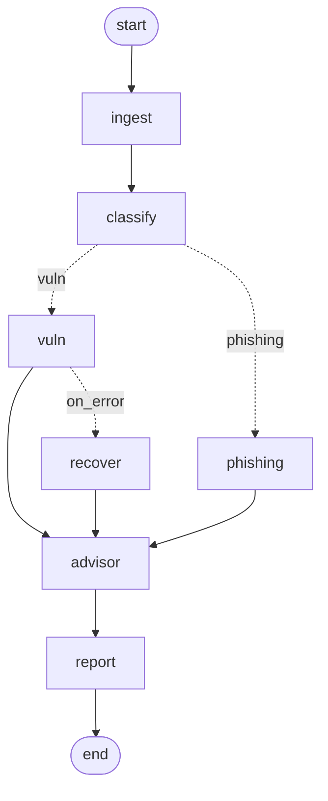

# SentinelAI — Workflow Engine (Phase 2, Prompt 019)

A LangGraph-style workflow engine: build directed graphs of state functions with
conditional routing, retry, error recovery, monitoring, logging, and visualisation.
No agent logic — nodes are arbitrary state functions. Lives at
`backend/app/ai/workflows/engine.py`.

## Why a built-in executor *and* LangGraph

The engine runs on a dependency-free executor (so workflows run and are fully
testable without LangGraph) and can also `to_langgraph()`-compile to a real
`StateGraph` for LangGraph's runtime, checkpointing, and graph rendering. State is a
plain dict: a node receives the state and returns a dict of updates, merged in.

## Builder API

```python
from app.ai.workflows import WorkflowBuilder, END

wf = (
    WorkflowBuilder("pipeline")
    .add_node("ingest", ingest_fn)
    .add_node("classify", classify_fn)
    .add_node("vuln", vuln_fn, retries=2, on_error="recover")   # retry + recovery
    .add_node("recover", recover_fn)
    .add_node("report", report_fn)
    .set_entry("ingest")
    .add_edge("ingest", "classify")
    .add_conditional_edges("classify",                           # conditional routing
                           lambda s: s["workflow"],
                           {"vuln": "vuln", "phishing": "phishing"})
    .add_edge("vuln", "report")
    .add_edge("recover", "report")
    .add_edge("report", END)
    .build()
)

result = wf.run({"workflow": "vuln"})
result.status      # "completed" | "failed"
result.state       # final merged state
result.events      # per-node NodeEvent (attempt, status, latency, error)
```

| Requirement | How |
|-------------|-----|
| Workflow / Graph builder | `WorkflowBuilder` fluent API → `CompiledWorkflow` |
| Node registration | `add_node(name, fn, retries=, retry_backoff_s=, on_error=)` (duplicate/invalid rejected at `build()`) |
| Conditional routing | `add_conditional_edges(src, router, mapping)` |
| State management | dict state, merged from each node's returned updates |
| Retry logic | per-node `retries` + backoff; emits `retried`/`success`/`failed` events |
| Node timeout | per-node `timeout_s` (soft, thread-based); a hang counts as a failure → retry/`on_error` |
| Error recovery | per-node `on_error` routes to a recovery node on failure (exceptions **and** timeouts) |
| Execution monitoring | `ExecutionMonitor(on_event=...)` for live events; `result.events` for the full trace |
| Logging | namespaced logger on routing/recovery |
| Visualisation | `to_mermaid()` (always) and `to_langgraph()` (LangGraph graph rendering) |
| Safety | `max_steps` guard prevents infinite loops on cyclic routing |

## Visualisation

`to_mermaid()` renders the graph. Example (generated by the engine itself — see
`docs/diagrams/workflow_engine_example.mmd`):



Solid arrows are static edges; dotted arrows are conditional routes (labelled by the
router key) and `on_error` recovery edges.

**Runtime trace.** Pass a run result to highlight what actually happened:
`wf.to_mermaid(result)` colours executed nodes green and failed nodes red (via
Mermaid `classDef`), turning the structural diagram into an execution trace — tying
the monitoring and visualisation requirements together.

## Tests

`backend/tests/ai/test_workflow_engine.py` — 11 tests: linear execution + state
merge, node-registration validation, conditional routing, retry-then-success, error
recovery routing, failure without recovery, live execution monitoring, the max-steps
guard, Mermaid output, and **real LangGraph compilation + invocation**.

```
cd backend && pytest tests/ai/test_workflow_engine.py -q
```

## Notes

- Soft timeout convention (as elsewhere) — node-level hard timeouts can be added if
  needed; retries/recovery cover transient failures.
- Complements the simpler `SequentialWorkflow` and the `WorkflowState` (Prompt 015):
  use this engine when you need branching, retry, and recovery.
- Not yet wired into the running pipeline (tracked) — it's the orchestration layer the
  real agents will be assembled on.
